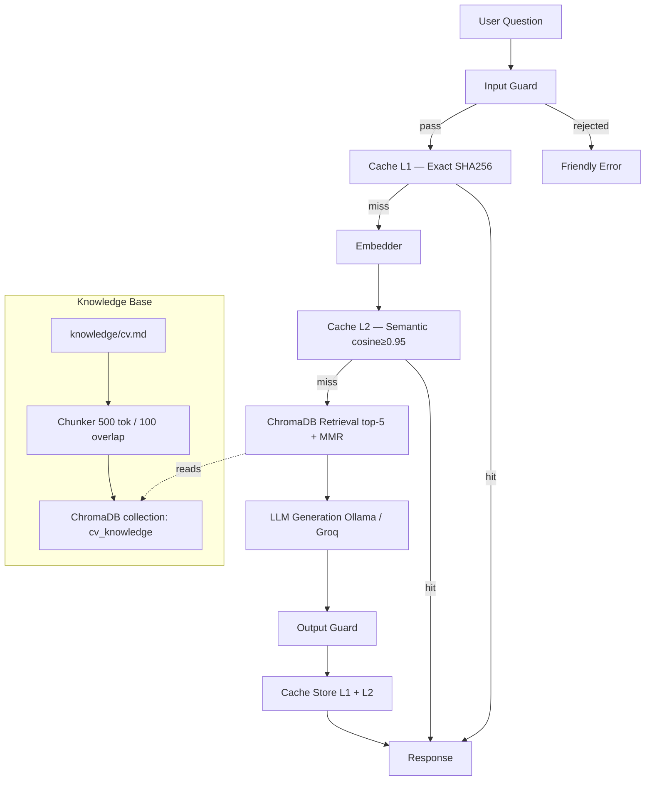

# Nabucodonosor 🔍

> *A production-grade RAG system that answers questions about my professional background — built as a portfolio showcase of AI Engineering fundamentals.*

[](https://www.python.org/downloads/)
[](https://www.gnu.org/licenses/gpl-3.0)
[](https://ollama.com)
[](https://www.trychroma.com/)
[](https://streamlit.io)

---

## What Is This?

**Nabucodonosor** is a Retrieval-Augmented Generation (RAG) system built from scratch — no LangChain, no LlamaIndex — that answers natural-language questions about my CV and professional experience. Recruiters and engineers can ask things like:

- *"What cloud platforms has Marcos worked with?"*
- *"Does Marcos have experience with vector search?"*
- *"What was his most recent project?"*

The system retrieves the most relevant chunks from my CV, feeds them as context to a local LLM, and returns a grounded, cited answer. It runs entirely on open-source models via [Ollama](https://ollama.com), with a [Groq](https://groq.com) backend for the production deployment on HuggingFace Spaces.

> **Why "Nabucodonosor"?** Nebuchadnezzar II was the Babylonian king known for his ability to recall and interpret knowledge. Fitting for a system whose sole purpose is to answer questions from a knowledge base.

---

## Live Demo

🚀 **[Try it on HuggingFace Spaces →](https://huggingface.co/spaces/vinicodex/nabucodonosor)**

---

## Architecture Overview

The pipeline runs in seven stages, each independently testable and replaceable.

```
┌─────────────────────────────────────────────────────────────────────┐
│                        User Question                                 │
└─────────────────────┬───────────────────────────────────────────────┘
                       │
                       ▼
┌──────────────────────────────────────┐
│           Input Guard                │  ← topic classifier + injection
│  · off-topic? → friendly rejection  │    detection (regex + embedding)
│  · prompt injection? → 400          │
│  · length > 500 chars? → 400        │
└──────────────────────┬───────────────┘
                       │
                       ▼
┌──────────────────────────────────────┐
│         Cache L1 — Exact             │  ← SQLite, TTL 24h
│  · SHA256(normalized_question) hit?  │    ~0ms round-trip
│  · yes → return cached answer        │
└──────────────────────┬───────────────┘
                       │ miss
                       ▼
┌──────────────────────────────────────┐
│         Embedder                     │  local:  Ollama nomic-embed-text
│  question → 768-dim float vector     │  prod:   sentence-transformers
└──────────────────────┬───────────────┘
                       │
                       ▼
┌──────────────────────────────────────┐
│         Cache L2 — Semantic          │  ← ChromaDB, cosine ≥ 0.95
│  · similar question already cached? │    ~5ms round-trip
│  · yes → return cached answer        │
└──────────────────────┬───────────────┘
                       │ miss
                       ▼
┌──────────────────────────────────────┐
│         ChromaDB Retrieval           │  top-5 chunks
│  · vector similarity search          │  + MMR reranking for diversity
│  · returns chunks + metadata         │
└──────────────────────┬───────────────┘
                       │
                       ▼
┌──────────────────────────────────────┐
│         LLM Generation               │  local:  Ollama llama3.2:3b
│  system prompt + context + question  │  prod:   Groq llama-3.2-3b
│  → structured JSON response          │
└──────────────────────┬───────────────┘
                       │
                       ▼
┌──────────────────────────────────────┐
│         Output Guard                 │  ← hallucination check
│  · answer grounded in context?       │    citation verification
│  · confidence score attached         │
│  · sensitive data filtered           │
└──────────────────────┬───────────────┘
                       │
                       ▼
┌──────────────────────────────────────┐
│   Cache Store (L1 + L2) + Response   │
│   { answer, sources, latency_ms,     │
│     cache_hit, confidence }          │
└──────────────────────────────────────┘
```

### Architecture Diagram (Mermaid)



---

## Key Engineering Decisions

| Decision | Choice | Why |
|---|---|---|
| **No orchestration framework** | Raw library calls | LangChain/LlamaIndex hide complexity — building from scratch demonstrates deeper understanding and produces leaner, more maintainable code |
| **Open-source LLMs** | Ollama (local) + Groq (prod) | Zero inference cost, data privacy, same open-source model family across environments |
| **Two-tier cache** | SQLite (exact) + ChromaDB (semantic) | Exact match handles repeated questions in <1ms; semantic match handles paraphrases; both are independent and fail-safe |
| **MMR retrieval** | Maximum Marginal Relevance | Pure top-k often returns near-duplicate chunks; MMR trades marginal relevance for diversity, improving answer quality |
| **Guard rails over training** | Embedding-based classifier | No fine-tuning needed; a topic guard using anchor embeddings generalizes without labeled data |
| **ChromaDB** | Persistent on-disk | Zero infrastructure to stand up, production-ready for single-node workloads, trivially replaceable with Qdrant/Weaviate for scale |
| **RAGAS for evaluation** | Automated LLM-as-judge | Covers faithfulness + relevancy without expensive human annotation; reproducible CI-friendly scores |

---

## Tech Stack

| Layer | Local (dev) | Production (HF Spaces) |
|---|---|---|
| **LLM** | Ollama `llama3.2:3b` | Groq API `llama-3.2-3b-preview` |
| **Embeddings** | Ollama `nomic-embed-text` (768-dim) | `sentence-transformers/all-MiniLM-L6-v2` |
| **Vector Store** | ChromaDB (persisted to disk) | ChromaDB (pre-built index in repo) |
| **Cache L1** | SQLite (exact hash, TTL 24h) | SQLite |
| **Cache L2** | ChromaDB (semantic similarity) | ChromaDB |
| **API** | FastAPI + Uvicorn | — |
| **UI** | Streamlit | HuggingFace Spaces (Streamlit) |
| **Infra** | Docker Compose | HF Spaces + Secrets |
| **Eval** | RAGAS | — |
| **Package manager** | uv | — |
| **Linting** | Ruff + mypy | — |

---

## Project Structure

```
nabucodonosor/
├── knowledge/
│   └── cv.md                      # The source of truth — CV in Markdown
│
├── src/nabucodonosor/
│   ├── config.py                  # Pydantic BaseSettings (env-driven)
│   ├── ingestion/
│   │   ├── loader.py              # Reads knowledge/*.md files
│   │   └── chunker.py             # Paragraph-aware chunking (500 tok / 100 overlap)
│   ├── embedding/
│   │   └── embedder.py            # Abstraction: Ollama ↔ sentence-transformers
│   ├── vectorstore/
│   │   └── chroma.py              # ChromaDB: upsert, search, delete
│   ├── retrieval/
│   │   └── retriever.py           # Top-k + MMR reranking
│   ├── generation/
│   │   ├── llm.py                 # Abstraction: Ollama ↔ Groq
│   │   └── prompts.py             # System prompt + RAG prompt templates
│   ├── cache/
│   │   ├── exact.py               # L1: SHA256 → SQLite (fail-safe)
│   │   └── semantic.py            # L2: cosine similarity → ChromaDB
│   ├── guardrails/
│   │   ├── input_guard.py         # Topic classifier + injection detection
│   │   └── output_guard.py        # Citation check + confidence scoring
│   ├── eval/
│   │   └── runner.py              # RAGAS metrics runner
│   └── pipeline.py                # Main orchestrator — wires everything together
│
├── app/
│   └── streamlit_app.py           # Chat UI with source citations
├── api/
│   └── main.py                    # FastAPI REST layer
├── scripts/
│   ├── ingest.py                  # Build / rebuild the vector index
│   └── run_eval.py                # Run the evaluation suite
├── eval/
│   └── golden_dataset.json        # 25 hand-crafted Q&A pairs
├── tests/                         # Unit tests for each module
├── pyproject.toml
├── docker-compose.yml
├── Dockerfile
└── .env.example
```

---

## Guard Rails

The system enforces two guardrail layers — one on input, one on output.

### Input Guard (`src/nabucodonosor/guardrails/input_guard.py`)

| Check | Method | Action on Fail |
|---|---|---|
| Length limit | `len(question) > 500` | Reject with "Question too long" |
| Prompt injection | Regex patterns (`ignore previous`, `disregard`, `<\|`, `system:`) | Reject with "Invalid request" |
| Topic relevance | `cosine_sim(embed(question), anchor_embeddings) < 0.5` | Reject with "I can only answer questions about Marcos' professional background" |

The topic classifier uses a small set of fixed anchor sentences representing career/professional topics and measures cosine similarity between the question embedding and those anchors — no labeled training data needed.

### Output Guard (`src/nabucodonosor/guardrails/output_guard.py`)

| Check | Method | Action on Fail |
|---|---|---|
| Groundedness | Term overlap between answer and retrieved chunks | Flag as `low_confidence` |
| Confidence | LLM self-reports `"high" \| "medium" \| "low"` in JSON output | Shown to user |
| Sensitive data | Regex filter for phone numbers / full email | Partial masking |

---

## Two-Tier Cache

```
Request                     Cache L1 (Exact)         Cache L2 (Semantic)
   │                             │                          │
   │──── SHA256(question) ──────▶│                          │
   │                             │ hit: ~0ms                │
   │◀─────────────────────────── │ miss ────────────────────▶│
   │                                                         │ hit: ~5ms (cosine ≥ 0.95)
   │◀──────────────────────────────────────────────────────── │
   │                                              miss → LLM call (~800ms-3s)
```

- **L1 (SQLite)**: stores `SHA256(normalized_question) → response`. Deterministic. Zero-cost. 24h TTL, cleared on re-ingestion.
- **L2 (ChromaDB)**: stores question embeddings alongside answers. Catches paraphrases ("What tech does Marcos know?" ≈ "Which technologies has Marcos used?"). Both caches are **fail-safe** — if either errors out, the pipeline continues to the LLM without breaking the user experience.

---

## Evaluation

The system ships with an automated eval suite based on **RAGAS** — a reference-free evaluation framework that uses an LLM-as-judge to score RAG pipelines without expensive human annotation.

### Metrics

| Metric | Measures | Target |
|---|---|---|
| `faithfulness` | Does the answer only state facts present in the retrieved context? | ≥ 0.80 |
| `answer_relevancy` | Is the answer relevant to the question asked? | ≥ 0.80 |
| `context_precision` | Were the retrieved chunks relevant to the question? | ≥ 0.75 |
| `context_recall` | Did retrieval surface all relevant chunks? | ≥ 0.70 |

### Running the Eval

```bash
python scripts/run_eval.py
# → prints a table + writes eval/results_<date>.md
```

The golden dataset (`eval/golden_dataset.json`) contains 25 hand-crafted Q&A pairs covering: current role, technologies, cloud platforms, specific projects, education, and soft skills.

---

## Quick Start (Local — Docker Compose)

**Prerequisites**: Docker Desktop, 4GB free RAM (for the LLM).

```bash
# 1. Clone and configure
git clone https://github.com/vinicodex/nabucodonosor.git
cd nabucodonosor
cp .env.example .env

# 2. Start Ollama and pull models
docker compose up -d ollama
docker compose exec ollama ollama pull llama3.2:3b
docker compose exec ollama ollama pull nomic-embed-text

# 3. Add your CV and build the vector index
# (edit knowledge/cv.md first)
python scripts/ingest.py

# 4. Start the app
docker compose up app
# → open http://localhost:8501
```

### Without Docker (uv)

```bash
pip install uv
uv sync
uv run python scripts/ingest.py
uv run streamlit run app/streamlit_app.py
```

---

## Configuration

All configuration is driven by environment variables (`.env` file or OS env).

| Variable | Default | Description |
|---|---|---|
| `LLM_PROVIDER` | `ollama` | `"ollama"` or `"groq"` |
| `OLLAMA_BASE_URL` | `http://localhost:11434` | Ollama server URL |
| `LLM_MODEL` | `llama3.2:3b` | Model name for Ollama |
| `GROQ_API_KEY` | — | Required if `LLM_PROVIDER=groq` |
| `GROQ_MODEL` | `llama-3.2-3b-preview` | Model for Groq |
| `EMBED_PROVIDER` | `ollama` | `"ollama"` or `"sentence-transformers"` |
| `EMBED_MODEL` | `nomic-embed-text` | Embedding model (Ollama) |
| `CHROMA_PATH` | `./data/chroma_db` | Vector store persistence path |
| `CACHE_DB_PATH` | `./data/cache.db` | SQLite cache path |
| `SEMANTIC_CACHE_THRESHOLD` | `0.95` | Cosine similarity threshold for L2 cache |
| `RETRIEVAL_K` | `5` | Number of chunks to retrieve |
| `MAX_QUESTION_LENGTH` | `500` | Input length limit (characters) |

---

## Deploy to HuggingFace Spaces

```bash
# 1. Build the index locally
python scripts/ingest.py          # creates data/chroma_db/

# 2. Push to HF Spaces
# Create a Streamlit Space at huggingface.co/spaces
# Add secrets: GROQ_API_KEY, LLM_PROVIDER=groq, EMBED_PROVIDER=sentence-transformers

# 3. Push the repo (includes the pre-built ChromaDB index)
git add data/chroma_db/ && git commit -m "add pre-built vector index"
git push huggingface main
```

The Space uses Groq for LLM inference (free tier, open-source models) and runs embeddings locally via `sentence-transformers` on the Space's CPU. No GPU required.

---

## Bring Your Own CV

1. Replace `knowledge/cv.md` with your own CV in Markdown format
2. Update `eval/golden_dataset.json` with questions about your background
3. Re-run ingestion: `python scripts/ingest.py --reset`
4. Re-run eval: `python scripts/run_eval.py`

The system is intentionally model-agnostic and CV-agnostic — swap the knowledge base and you have a fresh RAG system.

---

## What This Project Demonstrates

This project was built to show practical AI Engineering skills beyond calling an LLM API:

- **RAG from scratch** — chunking strategy, embedding, vector search, prompt engineering
- **System design** — multi-layer caching, guard rails, evaluation pipeline
- **Production thinking** — dual-environment config (local Ollama vs. cloud Groq), Docker Compose, HF Spaces deploy
- **Observability** — every response carries `latency_ms`, `cache_hit`, `confidence`, and `sources`
- **Evaluation** — automated RAGAS metrics with a golden dataset, not just vibes

---

## Author

**Marcos Vinicius** · [github.com/vinicodex](https://github.com/vinicodex) · vinicodex@gmail.com

---

*Licensed under the [GNU General Public License v3.0](LICENSE)*
